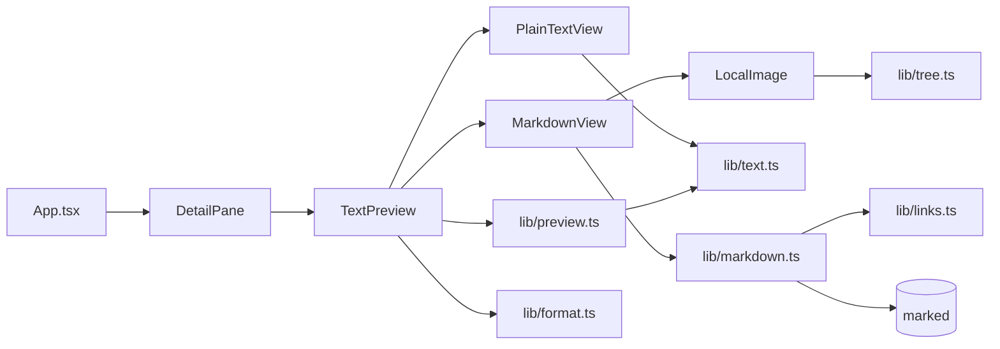
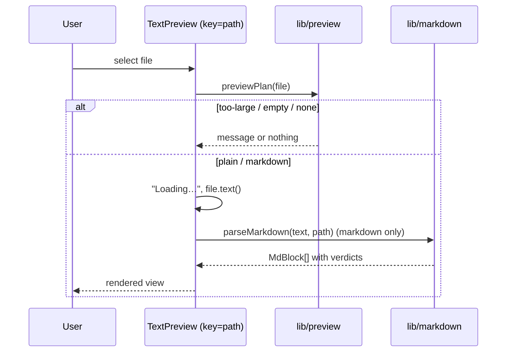

# Architecture Spine — Text & Markdown preview

## Design Paradigm

**Functional core, imperative shell** — ratified from the existing code.

- **Core — `src/lib/`**: plain TypeScript, no React. Decides *what* to show (file kind, state, link and image verdicts) and returns data. Unit-tested.
- **Shell — `src/components/`**: React. Reads files, owns object URLs and effects, renders the core's data. No decisions about files or URLs.
- **Strings — `src/lib/format.ts`**: every user-visible string, nowhere else.



Arrows are allowed imports. Nothing in `src/lib/` imports from `src/components/`; only `lib/markdown.ts` imports `marked`.

## Invariants & Rules

### AD-1 — One text classifier [ADOPTED]

- **Binds:** FR-1, FR-6, FR-7, line count
- **Prevents:** the Lines row and the preview disagreeing about whether a file is text.
- **Rule:** `isTextFile` in `lib/text.ts` is the only test for "text file", used by both the line count and the preview. The `.ts` override (FR-7) is added inside it, before the MIME check. `isMarkdownFile` (extension `md` / `markdown`) lives next to it and implies `isTextFile`.

### AD-2 — State is decided before reading

- **Binds:** FR-2, FR-3, FR-4, FR-5
- **Prevents:** reading a 50 MB file only to discard it; two components choosing different limits.
- **Rule:** `lib/preview.ts` exports `PREVIEW_MAX_BYTES = 1_048_576` and `previewPlan(file)` → `'none' | 'too-large' | 'empty' | 'plain' | 'markdown'`, from size and kind only. The shell reads the file (`file.text()`) only for `plain` and `markdown`. Comparison is `size > PREVIEW_MAX_BYTES`.

### AD-3 — Latest selection wins [ADOPTED]

- **Binds:** FR-5
- **Prevents:** a slow read of an earlier file overwriting the current one.
- **Rule:** `TextPreview` is mounted with `key={node.path}` and its read effect uses the `cancelled` flag in cleanup — the pattern in `DetailPane.tsx`. No shared preview state outside the keyed component.

### AD-4 — Decoding never fails visibly

- **Binds:** FR-8
- **Prevents:** a custom decoder or an error path for odd bytes.
- **Rule:** text comes only from `file.text()` (UTF-8 with replacement characters). If the read promise rejects, the Preview section (title included) renders nothing — no error string.

### AD-5 — `marked` is a lexer behind an app-owned model

- **Binds:** FR-9, FR-10, FR-11, NFR-2, NFR-5
- **Prevents:** marked's HTML output reaching the DOM; the renderer coupling to marked's token types; two renderers interpreting raw tokens differently.
- **Rule:** only `lib/markdown.ts` imports `marked`, and only calls its lexer with GFM on (tables, task lists, strikethrough, extended autolinks). `parseMarkdown(text, filePath)` (`filePath` = the Markdown file's `node.path`) returns the app's own `MdBlock[]` / `MdInline[]` types. Text in the model is display-ready (HTML entities decoded). Raw HTML tokens, block or inline, become plain text nodes holding the original source. Node kinds outside FR-9/FR-10 degrade to their plain text.

### AD-6 — Link and image verdicts live in the core

- **Binds:** FR-12, FR-13, FR-14, FR-15, NFR-1, NFR-2
- **Prevents:** a component rendering a URL it was never meant to see; two places deciding what is "web".
- **Rule:** `lib/links.ts` classifies; `parseMarkdown` stores the verdict in the model, so the renderer never sees a raw href or src.
  - Link → `{ kind: 'web', href }` only when the scheme is exactly `http:` or `https:`; everything else → `{ kind: 'inert' }` (no href kept).
  - Image → `{ kind: 'local', path }` when the src is a relative or `/`-rooted path that stays inside the folder after resolving `.` and `..` (relative to the Markdown file's directory; `/` = folder root; percent-encoding decoded, any `?query` or `#fragment` dropped); anything else (`http(s):`, `//`, `data:`, any scheme, escaping the folder) → `{ kind: 'placeholder' }`. `alt` is kept in both.
  - Paths are the tree's `node.path` form: root folder name first, `/`-separated.

### AD-7 — The DOM gets elements, never HTML strings

- **Binds:** FR-11, NFR-2
- **Prevents:** script or event-handler injection from a hostile file.
- **Rule:** the preview renders only React elements built from the model. `dangerouslySetInnerHTML` is banned in `src/` by ESLint `no-restricted-syntax`; importing `marked` outside `lib/markdown.ts` is banned by `no-restricted-imports`. Both fail `npm run check`.

### AD-8 — Rendered links and images

- **Binds:** FR-10, FR-12, FR-14, FR-15, NFR-1
- **Prevents:** the opened tab reaching back into the app; network image loads; a ticked box changing.
- **Rule:**
  - `web` link → `<a href target="_blank" rel="noopener noreferrer">`.
  - `inert` link → a `<span>` with the inert-link class; no `href`, not focusable.
  - `local` image → `LocalImage` looks up the `File` with `findFile(root, path)` from `lib/tree.ts`; found → ``, the URL created in an effect and revoked in its cleanup; not found → placeholder.
  - `placeholder` → a `<span>` with the alt text, or the "Image" string from `format.ts`.
  - The only `src` values ever rendered are `blob:` URLs from `URL.createObjectURL`.
  - Task-list checkboxes: `<input type="checkbox" disabled>` with `checked` from the model.

### AD-9 — The folder reaches the preview as a prop

- **Binds:** FR-12
- **Prevents:** a global or context store for the tree; image lookup living in two places.
- **Rule:** `App` passes the root `DirNode` to `DetailPane` as `root`; it flows down as a prop to `LocalImage`. No React context, no module-level cache.

## Consistency Conventions

| Concern | Convention |
| --- | --- |
| Files | Core: `preview.ts`, `markdown.ts`, `links.ts` new; `text.ts`, `tree.ts`, `format.ts` extended. Shell: `TextPreview.tsx`, `PlainTextView.tsx`, `MarkdownView.tsx` (with `LocalImage` inside or beside it). Each new core file gets a `*.test.ts`. |
| Names | Model types `MdBlock`, `MdInline`; verdict types `LinkTarget`, `ImageTarget`; kinds in kebab-case string unions. |
| Lines | `splitLines(text)` in `text.ts` splits on `\r\n` or `\n`; a trailing newline adds no empty last line — the same rule as `countLines`, so the gutter matches the Lines row. |
| Strings | "Preview", "Loading…", "File too large to preview", "Empty file", "Image" live in `format.ts`. |
| Styles | Class names only; CSS in `src/styles/app.css`. New tokens `--font-mono`, `--font-size-xl`, `--line-height-read`, `--reading-max-width` go in `tokens.css` (DESIGN.md). |
| State | Per-file state in components keyed by `node.path`; no state survives a selection change; nothing stored (NFR-3). The detail pane's scroll container (in `App`) returns to the top when the selected path changes (EXPERIENCE.md). |
| Tests | Core logic tested with Vitest without a DOM, including a hostile Markdown fixture (script, `onerror`, `javascript:`, remote image) asserting the model holds only text, `inert` and `placeholder`. |

## Stack

| Name | Version |
| --- | --- |
| React | 19.3.1 |
| TypeScript | 6.0.3 |
| Vite | 8.3.4 |
| Vitest | 5.0.5 |
| marked (new, owner-approved 2026-10-22) | 18.1.1 |
| Node (CI) | 24 |

## Structural Seed

```text
src/
  lib/
    text.ts          # isTextFile (+ .ts override), isMarkdownFile, splitLines
    preview.ts       # PREVIEW_MAX_BYTES, previewPlan
    markdown.ts      # parseMarkdown → MdBlock[] (only marked importer)
    links.ts         # classifyLink, classifyImage
    tree.ts          # + findFile(root, path)
    format.ts        # + preview strings
  components/
    DetailPane.tsx   # + root prop, mounts TextPreview
    TextPreview.tsx  # plan, read, Loading / messages, picks the view
    PlainTextView.tsx
    MarkdownView.tsx # renders the model; LocalImage
  styles/
    tokens.css       # + 4 tokens
    app.css          # + preview classes
```



## Capability → Architecture Map

| Capability | Lives in | Governed by |
| --- | --- | --- |
| FR-1 plain text view | `PlainTextView`, `text.splitLines` | AD-2, Lines convention |
| FR-2 Loading | `TextPreview` | AD-2, AD-3 |
| FR-3 size limit, FR-4 empty | `preview.previewPlan` | AD-2 |
| FR-5 latest selection | `TextPreview` key | AD-3 |
| FR-6, FR-7 text detection | `text.isTextFile` | AD-1 |
| FR-8 unusual content | `TextPreview` read | AD-4 |
| FR-9, FR-10, FR-11 rendered view | `markdown.parseMarkdown`, `MarkdownView` | AD-5, AD-7 |
| FR-12, FR-13 images | `links.classifyImage`, `LocalImage`, `tree.findFile` | AD-6, AD-8, AD-9 |
| FR-14, FR-15 links | `links.classifyLink`, `MarkdownView` | AD-6, AD-8 |
| NFR-1 no network | links + images | AD-6, AD-8, existing ESLint globals ban |
| NFR-2 no code from files | markdown model + render | AD-5, AD-7 |
| NFR-3 nothing stored, NFR-4 read-only | whole epic | State convention, existing read-only picker |
| NFR-5 dependency approval | `package.json` | Stack (approved) |

## Deferred

- **Double read.** The Lines row and the preview each call `file.text()` (up to 1 MB twice). Merge only if measured slow.
- **Large plain-text rendering.** A 1 MB file can be ~50,000 rows; no virtualization now. Revisit if the running app is slow (PRD validation medium 1).
- **Link-to-file navigation and `#heading` jumps.** Out of scope (PRD §7.2); the `inert` verdict is where they would hook in.
- **Dotfiles as text** (`.gitignore`). A known bug in `extension()`, reported, not part of this epic.
- **`CLAUDE.md` `.ts` pitfall.** Updated by the story that builds FR-7 (PRD addendum), not an architecture decision.
- **Deployment and operations.** Unchanged: static build to GitHub Pages via the existing workflow; this epic adds no runtime, server or storage.
